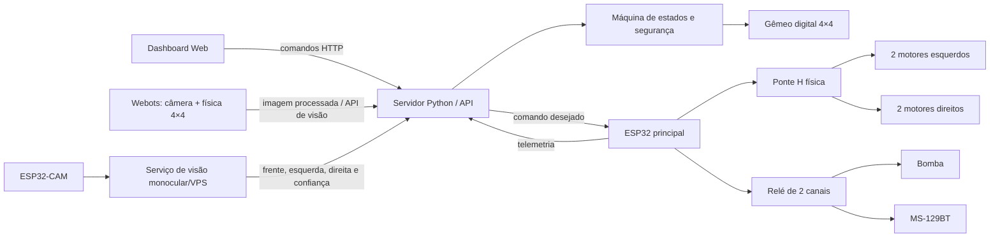

# Arquitetura do sistema

## Visão geral



O servidor é a fonte de verdade durante a etapa digital. Ele calcula saídas, aplica as proteções e disponibiliza o mesmo comando que a ESP32 física consulta. Quando a placa envia telemetria, o Dashboard identifica sua presença sem abandonar a simulação.

## Estados

| Modo | Finalidade |
|---|---|
| `PARADO` | Estado inicial e seguro; motores desligados. |
| `MANUAL` | Direção comandada pelo operador. |
| `AUTONOMO` | Decisão de movimento baseada exclusivamente nas métricas extraídas da câmera. |

Estados de proteção podem sobrepor o modo:

- `EMERGENCIA`: parada local ou pelo Dashboard.
- `SEM_CONEXAO`: enlace interrompido no cenário.
- `SEM_COMANDO`: ausência de heartbeat manual por 750 ms.
- `SEM_VISAO`: imagem ausente, antiga ou com confiança insuficiente no modo autônomo.
- `OBSTACULO`: visão frontal estima bloqueio a 25 cm ou menos.

## Regras de segurança

1. Todas as saídas iniciam desligadas.
2. Emergência e perda de enlace desligam motores, bomba e som.
3. Timeout manual zera o comando e os motores.
4. Soltar uma direção solicita zero e interrompe os motores imediatamente.
5. A bomba é limitada a três segundos por pulso.
6. No modo autônomo, perda da visão interrompe o movimento.
7. No modo manual, a câmera não escolhe nem corrige a trajetória do operador.
8. Quando a câmera estima bloqueio frontal, o autônomo pode girar para o lado visualmente mais livre.
9. O firmware possui um segundo timeout local de 1 segundo; portanto, uma falha do servidor também termina em parada.

Não há HC-SR04, lidar, sensor infravermelho ou distância fornecida pelo motor de física. O Webots fornece somente pixels da câmera ao algoritmo de navegação. A API de Supervisor é usada apenas para desenhar as gotas da bomba.

## Mistura diferencial

O Dashboard envia aceleração `T` e esterçamento `S`, ambos entre −100 e 100:

```text
esquerda = T + S
direita  = T - S
```

Os valores são normalizados para preservar a faixa de −100 a 100. No hardware, cada saída controla dois motores do mesmo lado. A ligação em paralelo e o número de drivers só podem ser definidos depois de medir a corrente de travamento de cada motor.

## Pinagem provisória

| Função | GPIO ESP32 |
|---|---:|
| Ponte H esquerda IN1 | 18 |
| Ponte H esquerda IN2 | 19 |
| Ponte H esquerda PWM | 23 |
| Ponte H direita IN1 | 16 |
| Ponte H direita IN2 | 17 |
| Ponte H direita PWM | 22 |
| Relé da bomba | 25 |
| Relé do som | 26 |
| Emergência local | 32, ativo em nível baixo |

Os relés são tratados como ativos em nível baixo. Isso deverá ser confirmado no módulo físico antes de conectar cargas.

## API HTTP

### Consultar estado

```http
GET /api/state
```

### Selecionar modo

```json
POST /api/command
{"action":"set_mode","mode":"MANUAL"}
```

### Dirigir

```json
POST /api/command
{"action":"drive","throttle":60,"steering":-20}
```

### Acionar bomba

```json
POST /api/command
{"action":"pump","enabled":true,"duration_ms":2000}
```

### Alternar som

```json
POST /api/command
{"action":"sound","enabled":true}
```

### Emergência

```json
POST /api/command
{"action":"emergency","active":true}
```

### Alterar o cenário

```json
POST /api/simulation
{"vision_front_cm":18,"vision_left_cm":24,"vision_right_cm":76,"vision_confidence":0.9}
```

### Publicar percepção da ESP32-CAM ou Webots

```json
POST /api/vision
{"front_cm":82,"left_cm":44,"right_cm":57,"confidence":0.88,"source":"ESP32_CAM"}
```

### Integração da ESP32

```http
GET /api/robot/command
POST /api/robot/telemetry
```

Exemplo de telemetria:

```json
{
  "sequence": 42,
  "safety_stop": false,
  "emergency_button": false,
  "wifi_rssi_dbm": -52,
  "uptime_ms": 15340
}
```

## Percepção monocular

A ESP32-CAM fornecerá imagens para uma VPS ou computador local. O serviço de visão estima o espaço visível à frente e as distâncias laterais até as paredes, publicando o resultado na API. Ele não comanda GPIOs diretamente; timeout, emergência e acionamento dos motores permanecem sob responsabilidade da máquina de estados e da ESP32 principal.

No Webots, a estimativa usa segmentação piso/parede e projeção inversa no plano do chão. A escala absoluta depende da altura e inclinação conhecidas da câmera, do campo de visão calibrado e da hipótese de piso aproximadamente plano. A montagem física exigirá calibração intrínseca e extrínseca com alvos e medidas reais; nenhuma leitura ultrassônica será usada como substituta.
